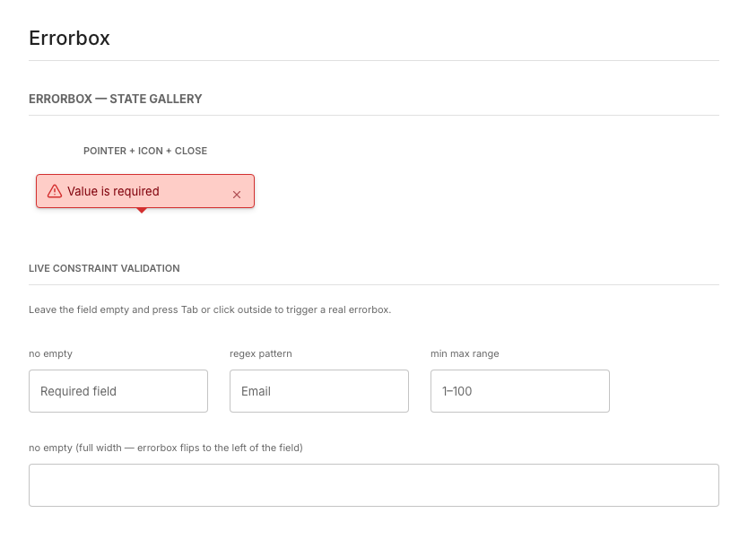
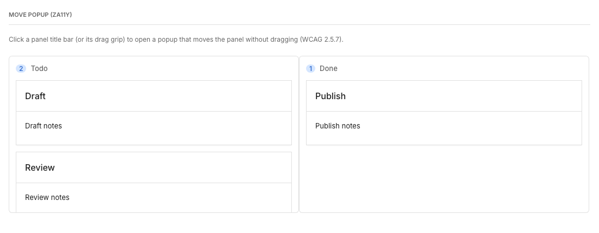
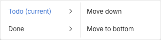
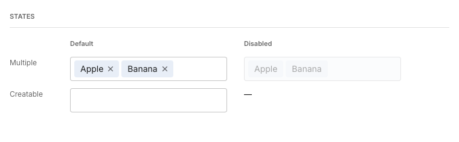

**Updated za11y support makes keyboard navigation, dashboard interactions, and compact controls easier to use.**

## Building on ZK's Accessibility Support

ZK provides the za11y accessibility module to help developers build applications that meet WCAG Level AA requirements. It adds accessibility behavior to supported ZK components, including keyboard interaction and semantic information for screen readers.

In ZK 11, za11y brings updated support for WCAG 2.2 Level AA. The improvements address everyday interactions: keeping focused controls visible when validation messages appear, letting users rearrange dashboard panels without dragging, and making small controls easier to select.

These enhancements are built into supported components, helping both new and existing applications provide more accessible interactions with less custom implementation work. Application teams still need to review their page structure, labels, content, styling, and complete workflows.

## Keep Keyboard Focus Visible

Keyboard users need to see which control currently has focus. WCAG 2.2 Success Criterion 2.4.11, Focus Not Obscured (Minimum), requires that a focused component is not completely hidden by content created by the application.

Validation messages are a common source of this problem. An error popup can appear directly over the next field a user has reached with the keyboard.

With ZK 11 and za11y, Errorbox checks the current focus when it opens or is repositioned. If its normal position would cover that focused component, ZK moves the message so the focused control remains visible. Existing validation declarations continue to work; the improvement is in the rendered behavior.



*Validation messages adjust their position to keep the focused field visible.*

```xml
<vlayout width="360px">
    <textbox placeholder="Account name"
             constraint="no empty: Please enter an account name"/>
    <textbox placeholder="Department"/>
</vlayout>
```

## Move PortalLayout Panels Without Dragging

Dashboards often let users reorganize panels by dragging them between columns. Dragging is convenient for many users, but it can be difficult for people with tremors, limited dexterity, or alternative pointer devices.

WCAG 2.2 Success Criterion 2.5.7, Dragging Movements, requires a single-pointer alternative unless dragging is essential or the behavior is controlled by the user agent.

ZK 11 adds a click-operated move interface to PortalLayout when za11y is active. A user selects a movable panel, chooses a destination column or row, and then chooses the new position. Dragging remains available, while the same result can be achieved without tracing a drag path.



*Move panels between Todo and Done without a drag gesture.*



*Clicking a panel title opens a keyboard-accessible destination and position menu.*

The destination menu also exposes names, roles, selection state, and keyboard navigation to assistive technology. Applications that implement custom drag-and-drop widgets still need to provide their own equivalent non-dragging operation.

## Make Small Controls Easier to Activate

Small icons can be visually clear yet difficult to select accurately. WCAG 2.2 Success Criterion 2.5.8, Target Size (Minimum), sets a 24 by 24 CSS-pixel minimum pointer target, with exceptions for spacing, equivalent controls, inline content, user-agent controls, and essential presentation.

The ZK 11 accessibility layer expands or protects the activation area for several compact controls:



*Chosenbox provides larger activation areas for remove controls while keeping the chips visually compact.*

- Tabbox close icons receive a 24 × 24 CSS-pixel hit target while the visible close glyph and tab spacing remain compact.

- Chosenbox item-remove buttons use a 24 × 24 activation box without enlarging the chip's visible hover circle.

- AnchorNav tracked links receive a minimum 24 × 24 target when page styling does not already provide a larger one.

- Biglistbox frozen-column controls reserve space for the draggable tick so adjacent pointer targets do not collide.

## Supporting Accessibility Improvements

The ZK 11 accessibility work also refines behavior associated with earlier WCAG requirements:

- **Pointer cancellation** - Popups, calendars, search lists, notifications, and similar floating content wait until the pointer is released before completing dismissal actions.

- **Hover and focus content** - Tooltip-like content can be dismissed with Escape and, where applicable, remains reachable by the pointer.

- **Status messages** - Live regions announce notifications, progress, date-range changes, and paging updates without moving keyboard focus.

- **Reflow and keyboard behavior** - Selected components improve popup sizing, focus movement, ARIA state, and keyboard interaction for zoomed and assistive-technology use.

## Enable Accessibility Support

za11y is a separate ZK EE module. Add it with the same version as the rest of the ZK libraries. Once it is on the classpath, it augments supported widgets with accessibility behavior and semantic information.

```xml
<dependency>
    <groupId>org.zkoss.zk</groupId>
    <artifactId>za11y</artifactId>
    <version>${zk.version}</version>
</dependency>
```

Depending on the component, za11y adds roles, accessible names, state information, live regions, and other ARIA attributes to support assistive technologies.

## Build Accessibility into the Complete Application

ZK's component support and application-level design work together to create an accessible experience. za11y supplies supported components with keyboard behavior and accessibility semantics, while application-specific labels, page structure, and content help users understand each screen and complete their tasks.

For example, a search field or icon-only button needs an accessible name that describes its purpose in the application:

```xml
<zk xmlns:ca="client/attribute">
    <textbox ca:aria-label="Search orders"/>
    <button iconSclass="z-icon-refresh"
            ca:aria-label="Refresh order status"/>
</zk>
```

ZK's accessibility documentation explains how to combine component capabilities with accessible headings, navigation, forms, and custom content. It also provides guidance for reviewing the resulting experience with keyboard and screen-reader testing.

## Review Accessibility in Your Application

Automated scans are useful, but they cannot judge a complete interaction. Review representative workflows with several methods:

- Run an automated tool such as axe or Lighthouse to identify potential accessibility issues.

- Follow the main workflow using only the keyboard, checking focus visibility and order, menus, dialogs, and validation messages.

- Check text resizing at 200% and reflow at a viewport equivalent to 320 CSS pixels wide. Review popup placement and access to controls.

- Check high-contrast or forced-colors mode to confirm that focus, selection, boundaries, and errors remain distinguishable.

- Use a screen reader to review control names, roles, states, status announcements, and reading order, including any custom widgets.

## Summary

This ZK 11 accessibility update provides:

- Errorbox placement that keeps the currently focused component visible

- A click-operated alternative for moving PortalLayout panels

- Larger activation areas or safer spacing for selected compact controls

- Improved pointer cancellation, status announcements, tooltip dismissal, keyboard handling, and reflow

- A stronger framework baseline for teams targeting WCAG 2.2 Level AA

## Try It in ZK 11 EE-Eval Freshly

ZK 11 is coming soon, and you can preview these accessibility improvements in the latest ZK 11 EE-Eval Freshly build (11.0.0.FL.20261030-Eval).

To try them in an existing ZK application, update the Maven configuration and keep all ZK dependencies on the same evaluation version.

**1. Add the ZK Evaluation Maven Repository**

```xml
<repositories>
    <repository>
        <id>ZK Evaluation</id>
        <url>https://mavensync.zkoss.org/eval/</url>
    </repository>
</repositories>
```

**2. Update the ZK version and add za11y**

```xml
<properties>
    <zk.version>11.0.0.FL.20261030-Eval</zk.version>
</properties>

<dependencies>
    <dependency>
        <groupId>org.zkoss.zk</groupId>
        <artifactId>za11y</artifactId>
        <version>${zk.version}</version>
    </dependency>
</dependencies>
```

Freshly evaluation builds provide a preview of upcoming features and are intended for evaluation. Refer to the final ZK 11 documentation and release notes when preparing a production upgrade.

For more details, see the [ZK Maven Setup Guide](https://docs.zkoss.org/zk_installation_guide/maven_setup).

## Resources

- [What's New in WCAG 2.2](https://www.w3.org/WAI/standards-guidelines/wcag/new-in-22/)

- [Web Content Accessibility Guidelines 2.2](https://www.w3.org/TR/WCAG22/)

- [ZK Accessibility documentation](https://docs.zkoss.org/zk_dev_ref/accessibility/accessibility)

- [ZK GitHub repository](https://github.com/zkoss/zk)
