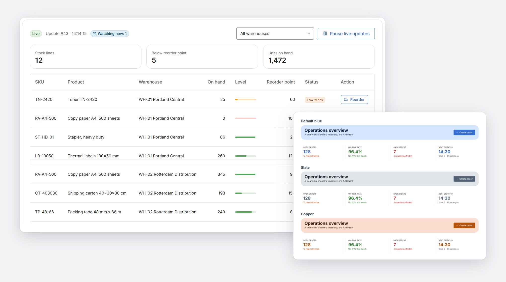
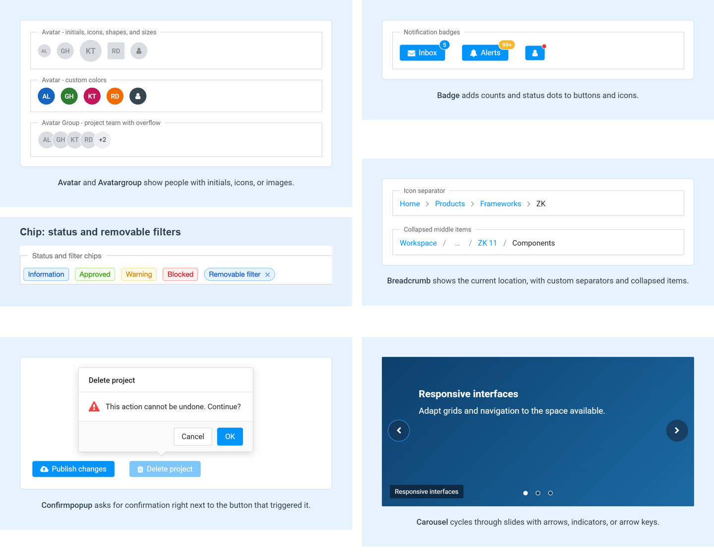
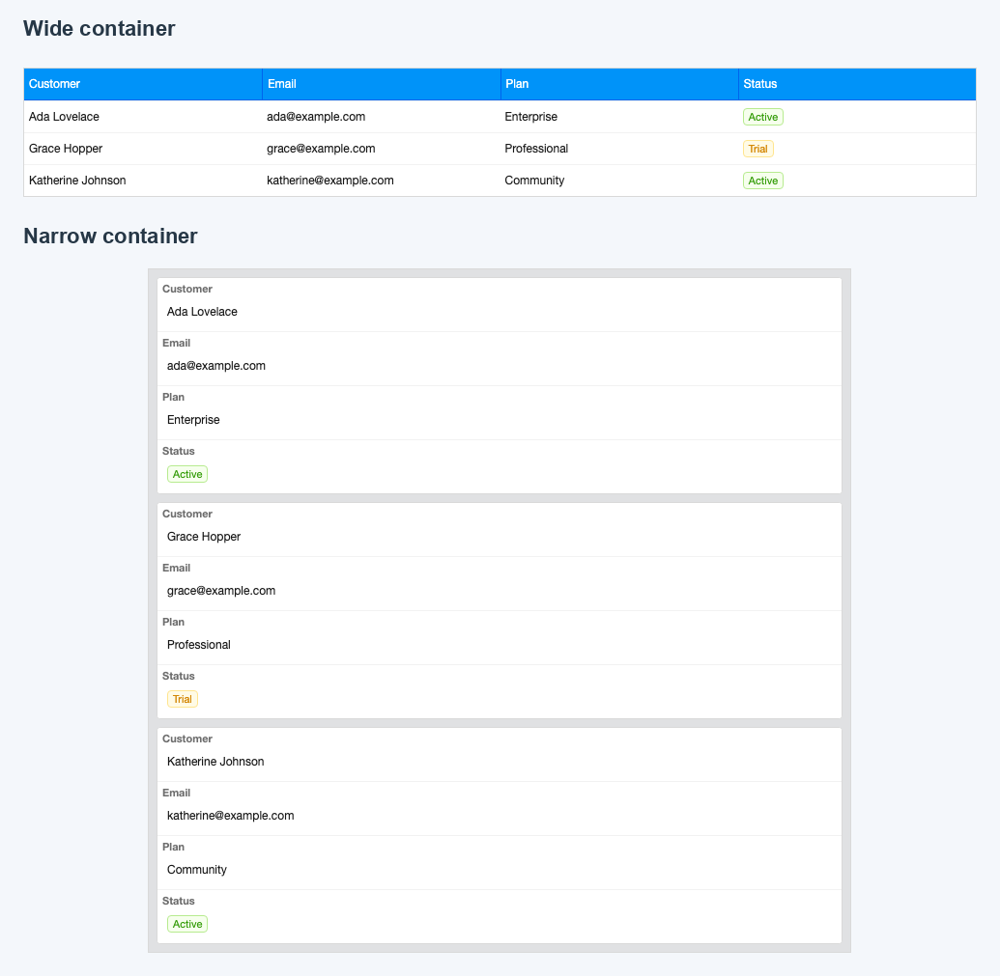
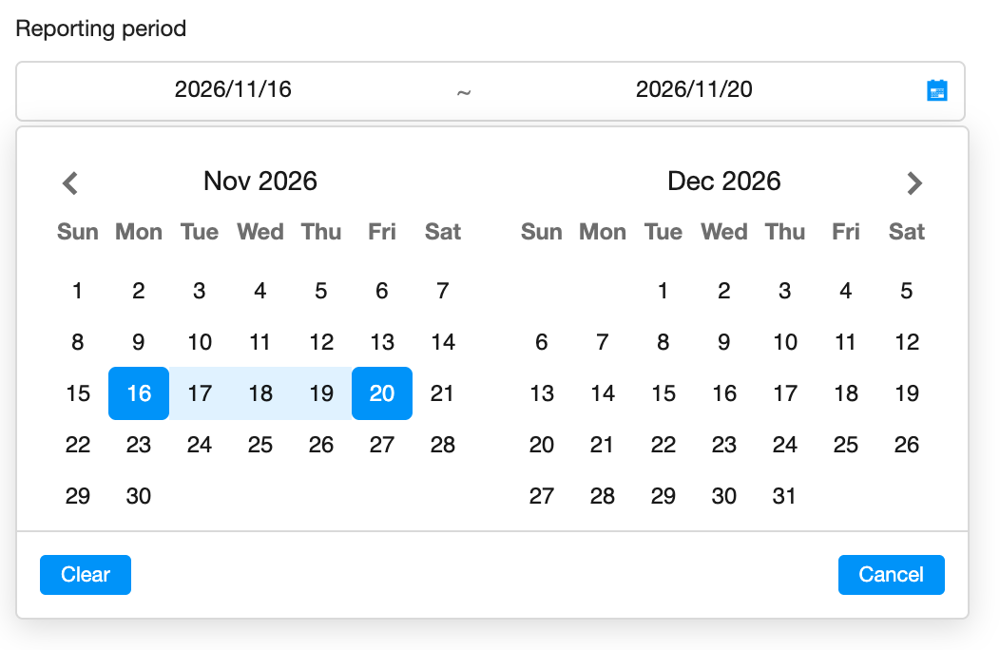
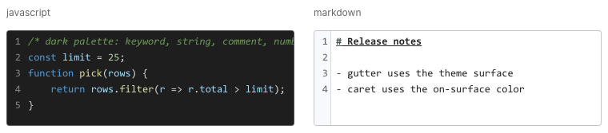
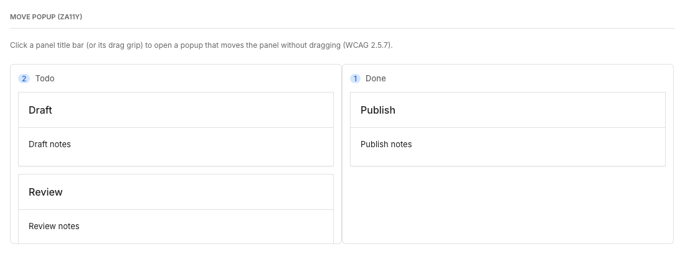
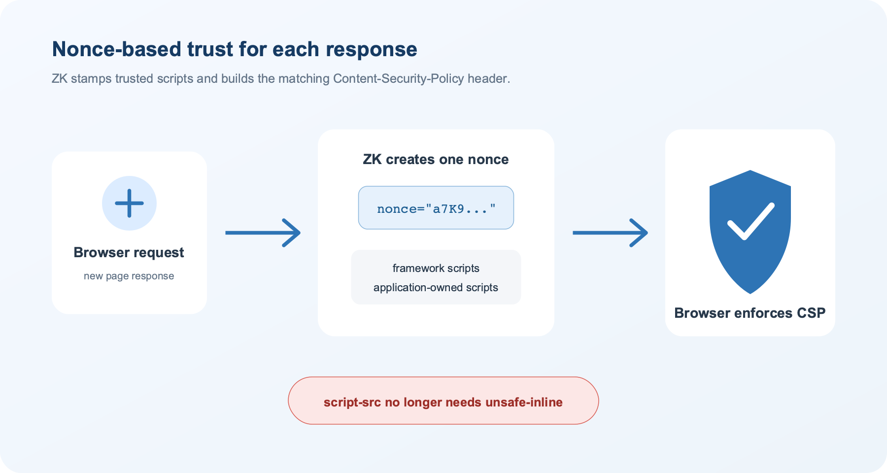

**Modern. Responsive. Secure.**

ZK 11 Beta is now available. It introduces the Marble theme with built-in styling utilities, new UI components, and responsive Grid and Listbox layouts. It also updates accessibility support for WCAG 2.2 AA, improves CSP support, and provides a Software Bill of Materials (SBOM) for dependency reviews.

<a class="btn btn--primary" href="https://www.zkoss.org/download/zk">Try ZK 11 Beta</a>
<a class="btn btn--primary" href="https://www.zkoss.org/product/zk/releasenote/11.0.0-Beta">View Release Notes</a>

## Marble Theme and Styling Utilities



Marble is the new default theme, based on Material Design 3. Set a primary brand color to update related component colors, choose comfortable or compact spacing, and use component-level CSS variables for targeted changes. Built-in utilities let you set margins, padding, gaps, colors, and flex or grid layouts directly in ZUL, reducing one-off CSS rules. Existing applications can keep the IceBlue theme while evaluating Marble. See [Marble customization and utility examples](/zk_style_customization_guide/marble_theme).

*Marble applied to an inventory interface, with default blue, slate, and copper color examples.*

## Seven Modern UI Components



[Avatar](/zk_component_ref/avatar) and [Avatargroup](/zk_component_ref/avatargroup) show team members or approvers; [Badge](/zk_component_ref/badge) highlights notifications; and [Chip](/zk_component_ref/chip) displays status or removable filters. [Breadcrumb](/zk_component_ref/breadcrumb) handles hierarchical navigation, [Confirmpopup](/zk_component_ref/confirmpopup) asks for confirmation beside an action, and [Carousel](/zk_component_ref/carousel) presents announcements or guided steps. All seven are included in Community Edition and work with standard ZUL, Java, and MVVM bindings. [Explore the new components and examples](/small-talk/2026/11/17/zk_11_sneak_peek_avatars_badges_and_more_for_modern_uis).

## Responsive Grid and Listbox



Grid and Listbox can change table rows into labeled cards when their container becomes narrow, whether on a phone or inside a dashboard panel. Configure breakpoints, the number of cards per row, and which fields appear in the stacked view. Existing models, renderers, selection, paging, and MVVM bindings continue to work. Available in Enterprise Edition. [See responsive layouts in action](/small-talk/2026/10/24/zk_11_sneak_peek_responsive_grids_and_listboxes_for_mobile_friendly_data_views).

*One Grid shown as a wide table and as cards in a narrow container.*

## Daterangebox for Start and End Dates



Daterangebox selects and edits a complete date range in one control, reducing the work of coordinating two date inputs. It supports multiple calendar panels, calendar-day duration limits, optional endpoints, and time selection. Bind a `DateRange` or the corresponding Java Time range type, or bind the endpoints separately. Available in Enterprise Edition. [See date-range configuration and binding examples](/small-talk/2026/11/01/zk_11_sneak_peek_easier_date_range_selection_with_daterangebox).

*The date-range input and its complete two-month popup, with the selected period highlighted.*

## Codeeditor for Structured Text



Codeeditor adds syntax highlighting and line numbers to applications for editing configuration files, SQL, JSON, templates, and source code. It supports light and dark color schemes and integrates with application logic through standard ZK value binding and input events. [See Codeeditor examples](https://docs.zkoss.org/small-talk/2026/11/23/zk_11_sneak_peek_syntax_highlighting_with_the_new_codeeditor.html).

*Codeeditor showing JavaScript in a dark color scheme and Markdown in a light color scheme.*

See the [Codeeditor component reference](/zk_component_ref/codeeditor) for configuration details and usage examples.

## Accessibility Updates for WCAG 2.2 AA



The za11y module updates ZK's accessibility support for WCAG 2.2 Level AA. Validation messages keep focused fields visible, PortalLayout panels can be moved without dragging, and selected compact controls have larger activation areas or safer spacing. Keyboard navigation, tooltip dismissal, and status announcements also improve. za11y is a separate module available with Enterprise Edition; application teams still need to review their labels, content, styling, and complete workflows. Read about [ZK accessibility support](/zk_dev_ref/accessibility/accessibility) and [PortalLayout's non-dragging alternative](/zk_component_ref/portallayout#accessibility).

*PortalLayout panels can be rearranged through a destination and position menu.*

## Improved CSP Support



ZK 11 builds on the CSP configuration introduced in ZK 10.3. In strict-dynamic mode, the generated `script-src` omits `unsafe-inline` unless a custom policy includes it. ZK-generated scripts receive the response nonce automatically, and application-owned scripts can use `cspNonce`. Current client-side behavior still requires `unsafe-eval`, and inline styles still require `unsafe-inline` in `style-src`. Start in report-only mode to check application compatibility. [See CSP configuration and nonce handling](/small-talk/2026/11/10/zk_11_sneak_peek_better_csp_support_for_secure_apps).

*A response nonce connects the CSP header with authorized scripts.*

## Software Bill of Materials



ZK 11 generates a separate CycloneDX JSON Software Bill of Materials (SBOM) for dependency and license reviews. Use the file matching your edition and version, or generate it from the matching source checkout. The source-build tasks produce standalone JSON reports; adding a normal ZK Maven dependency does not automatically retrieve an SBOM. Include your application's dependencies when building its inventory. [See how to obtain and use the SBOM](/zk_installation_guide/software_bill_of_materials).

## Additional Enhancements

<ul>
  <li> <strong>Smooth Frozen scrolling</strong>, previously an EE feature, is now available in all editions. It keeps contextual columns visible while navigating wide Grids. <a href="/zk_component_ref/frozen">Frozen reference</a>.</li>
  <li> <strong>Skeleton loading</strong> shows <code>rect</code>, <code>circle</code>, or <code>text</code> placeholders while component data is being prepared. Clear the <code>skeleton</code> property when content is ready. <a href="/zk_component_ref/htmlbasedcomponent#skeleton">Skeleton reference</a>.</li>
  <li> <strong>Borderlayout keyboard shortcuts</strong> use <code>ctrlKeys</code> and <code>onCtrlKey</code> to handle key combinations directly on the layout. <a href="/zk_component_ref/borderlayout">Borderlayout reference</a>.</li>
  <li> <strong>Chosenbox</strong> now supports contains-based filtering, allowing users to find options by matching text anywhere in their labels. Applications using <code>ListSubModel</code> can implement the corresponding filtering logic. <a href="/zk_component_ref/chosenbox#contains-filtering">Chosenbox reference</a>.</li>
  <li> The new <strong><code>stubonlyDescendants</code></strong> property selects eligible descendants by ZUL component name, reducing retained server-side state for static content. <a href="/zk_dev_ref/performance_tips/specify_stubonly_for_client_only_components#selecting-descendants-by-component-name">Stubonly reference</a>.</li>
  <li> <strong>Classpath label-resource locations</strong> support the <code>~./</code> prefix for label bundles packaged under <code>/web</code> in an addon or application JAR. <a href="/zk_config_ref/the_label_location_element#classpath-label-resources">Label-location reference</a>.</li>
  <li> <strong>Root HTML language</strong> is resolved automatically from the locale and can be overridden with <code>root-attributes</code>. CSP configuration elements are also declared in <code>zk.xsd</code>. <a href="/zuml_ref/processing_instructions/root_attributes#automatic-html-language">HTML language reference</a> and <a href="/zk_config_ref/the_csp-enabled_element">CSP configuration reference</a>.</li>
</ul>

## Before Upgrading

ZK 11 requires Java 17 or later, but upgrading the JDK does not by itself require migrating from `javax.servlet` to `jakarta.servlet`. Marble becomes the default theme, so review custom styling and choose whether to adopt Marble or explicitly keep IceBlue. Custom themes also need a review of theme-source imports and renamed CSS variables. Test a representative application before rollout. Review the [ZK 11 upgrade guidance](/zk_dev_ref/upgrade_tips/version_upgrade#zk-110) and [CSS variable migration guide](/zk_style_customization_guide/migration_guides/css_variables_10_3_to_11).

## Summary

ZK 11 Beta brings a modern default theme, new UI components, responsive data views, accessibility updates, and stronger security and dependency-review support to the familiar server-side Java programming model.

## Try ZK 11 Beta

Download ZK 11 Beta and try the features on a representative form, dashboard, or data view. Use Beta builds for evaluation and keep all ZK dependencies on the same version.

- [Download ZK](https://www.zkoss.org/download/zk)
- [Maven setup](/zk_installation_guide/maven_setup)
- [ZK 11.0.0-Beta release notes](https://www.zkoss.org/product/zk/releasenote/11.0.0-Beta)
