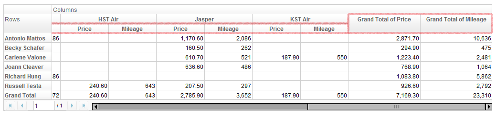
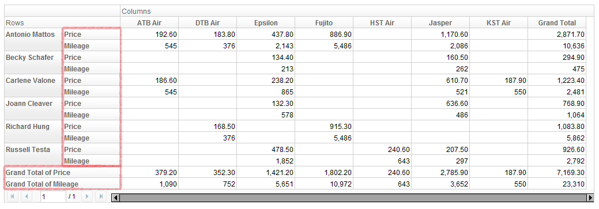
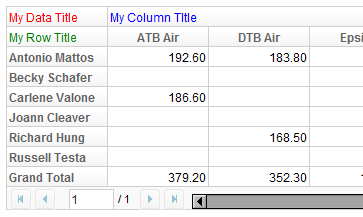
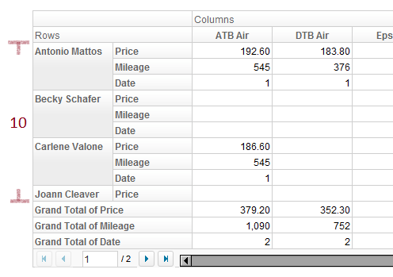

With a PivotModel, we can easily create a Pivottable component.

## Create a Pivottable

Given a PivotModel, creating a Pivottable is as simple as

```xml
<pivottable model="${model}" />
```

## Attributes

### Grand totals

You can show or hide grand total rows or columns by specfiying

```xml
<pivottable model="${model}" grandTotalForColumns="false" 
    grandTotalForRows="false" />
```

Default values are `true`.

### Data orientation

Data orientation means how to arrange data when there are more than one
data fields. For example, if we specify "Price" and "Mileage" as data
field,

```xml
<pivottable model="${model}" dataOrient="column" />
```

gives



and

```xml
<pivottable model="${model}" dataOrient="row" />
```

will give



### Height and frozen column headers

Do not set `height` on a Pivottable. Its `setHeight` method throws
`UnsupportedOperationException`. Instead, give a parent element a
definite height, and set `vflex="1"` on the Pivottable so it fills that
space.

Frozen column headers keep the column headers visible while the rows
scroll. Use `setFrozenColumnHeaders(boolean)` and
`isFrozenColumnHeaders()`. The default is `false`. Frozen headers take
effect only when the Pivottable has a bounded height, because the widget
computes its scrolling area from the client height.

```xml
<div height="400px">
    <pivottable model="${model}" vflex="1" frozenColumnHeaders="true" />
</div>
```

## Title Cells

Pivottable can accept up to 3 child components, which will represent the
3 title cells in the order of data title, column title, and row title.
For example,

```xml
<pivottable model="${model}">
    <div style="color: red">My Data Title</div>
    <div style="color: blue">My Column Title</div>
    <div style="color: green">My Row Title</div>
</pivottable>
```

results in



## Paging

As you have noticed, Pivottable has built-in paging support. Like Paging
on Grid or Listbox, you can set page size and current page number. For
example,

```xml
<!-- suppose model has Price, Mileage, Date as data field -->
<pivottable model="${model}" pageSize="10" dataOrient="row" />
```



Note:

- Page size does not include the size of grand total rows.
- Default page size is 20.

## Manipulation

Users can interact with a Pivottable in the following way:

- Open/close header nodes by clicking on the plus/minus sign on row and
  column fields.
- Resize column width by dragging their edge.

Other actions are available through call Pivottable API and PivotModel
API. The next section will introduce samples of wiring these API to the
user interface.

#
